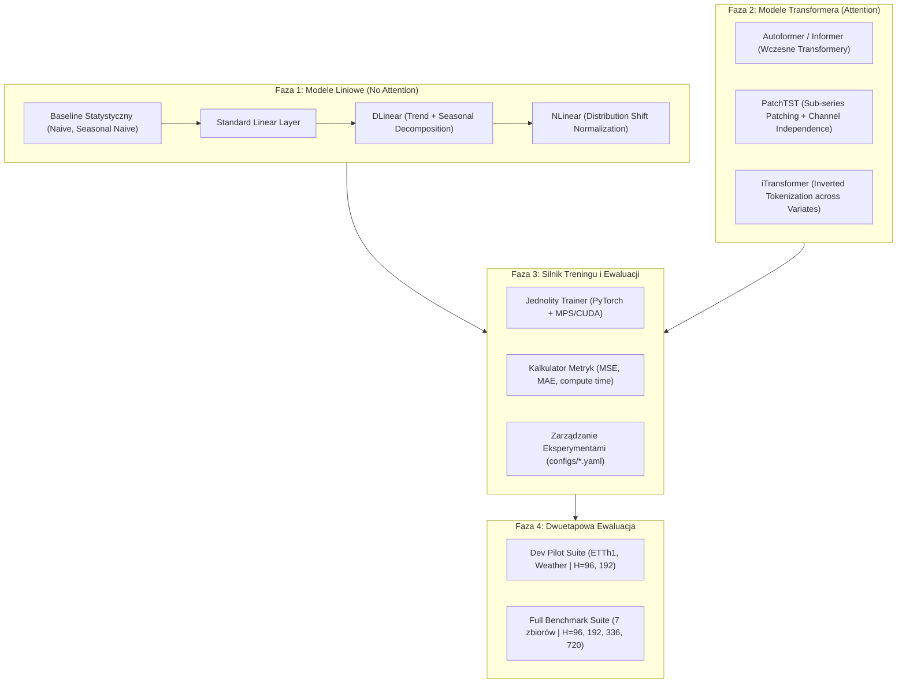

# Machine Learning Project 5: Roadmap & Implementation Plan
**"Prognozowanie szeregów czasowych: czy mechanizm uwagi jest potrzebny?"**
*(Time Series Forecasting: Is the Attention Mechanism Needed?)*

---

## 1. Executive Summary & Research Hypothesis

* **Core Question**: Czy mechanizm uwagi (Self-Attention) jest niezbędny do uzyskania najwyższej jakości prognoz w szeregach czasowych, czy też prostsze modele liniowe z dekompozycją szeregu (DLinear, NLinear) oferują porównywalną lub lepszą jakość przy ułamku kosztu obliczeniowego?
* **Experimental Scope**: Porównanie modeli liniowych (bez uwagi) z architekturami Transformerowymi (z uwagą) na kanonicznych benchmarkach LTSF (ETTh1, ETTh2, ETTm1, ETTm2, Weather, Electricity, Traffic).
* **Two-Tier Execution Strategy**:
  * **Dev / Pilot Mode**: Szybkie uruchomienia (ETTh1, Weather, horyzonty $H \in \{96, 192\}$, mała liczba epok/early stopping) do bieżącej weryfikacji i debugowania.
  * **Full Benchmark Mode**: Pełna macierz eksperymentalna ($7 \text{ zbiorów} \times 4 \text{ horyzonty } \{96, 192, 336, 720\}$) na potrzeby końcowego raportu i obrony.

---

## 2. Pytania Otwarte do Prowadzącego (Questions for Instructor)

Przed finalizacją implementacji zaawansowanych modeli warto skonsultować z prowadzącym następujące kwestie:

> [!IMPORTANT]
> 1. **Czysty PyTorch vs Biblioteki (`neuralforecast`)**:
>    Czy modele bardziej złożone (np. PatchTST, iTransformer, Autoformer) mogą korzystać ze zweryfikowanych implementacji z biblioteki `neuralforecast`, czy wszystkie modele muszą być zaimplementowane w czystym PyTorch od zera? *(Rekomendacja: podejście hybrydowe — DLinear/NLinear oraz rdzeń PatchTST od zera w PyTorch, a pozostałe/baseliny jako punkt odniesienia z `neuralforecast`)*.
> 2. **Wymagana macierz zbiorów i horyzontów**:
>    Czy ocena wymaga przetestowania pełnej macierzy 7 zbiorów na 4 horyzontach ($7 \times 4 = 28$ konfiguracji na model), czy dopuszczalne jest skupienie się na wybranej podgrupie (np. ETTh1, ETTm1, Weather, Electricity) dla horyzontów 96 i 336?
> 3. **Format raportu końcowego**:
>    Czy oczekiwany jest raport w formie Jupyter Notebook, publikacji w formacie LaTeX/PDF, czy repozytorium kodu z podsumowaniem w `results/`?

---

## 3. Szczegółowy Plan Implementacji (Phased Roadmap)

---

### Faza 1: Rodzina Modeli Liniowych (Czysty PyTorch & Baseline)
- [ ] **1.1. Naiwne bazy odniesienia**:
  - Implementacja `Naive` (ostatnia znana wartość) oraz `SeasonalNaive` (wartość z poprzedniego cyklu dobowego/tygodniowego) za pomocą `statsforecast`.
- [ ] **1.2. Prosty model liniowy (`Linear`)**:
  - Pojedyncza warstwa liniowa mapująca okno $L$ bezpośrednio w horyzont $H$.
- [ ] **1.3. `DLinear` (Dekompozycja szeregu)**:
  - Blok `SeriesDecomp` (średnia ruchoma wyodrębniająca trend i resztę sezonową).
  - Dwie niezależne warstwy liniowe: $W_{\text{trend}}$ dla trendu i $W_{\text{seasonal}}$ dla składowej okresowej.
  - Sumowanie wyjść: $\hat{Y} = \hat{Y}_{\text{trend}} + \hat{Y}_{\text{seasonal}}$.
- [ ] **1.4. `NLinear` (Normalizacja przesunięcia dystrybucji)**:
  - Odjęcie ostatniej wartości okna wejściowego ($X - X_{L}$), przejście przez warstwę liniową, dodanie $X_{L}$ do prognozy.
  - Eliminuje błąd przy trendach nieregularnych i gwałtownych zmianach średniej.

---

### Faza 2: Rodzina Transformera (Mechanizmy Uwagi)
- [ ] **2.1. Wczesne Transformery (Autoformer / Informer)**:
  - Wykorzystanie jako punkt odniesienia pokazujący, dlaczego klasyczny mechanizm uwagi zawodził na szeregach (głównie przez tokenizację pojedynczych kroków czasowych).
- [ ] **2.2. `PatchTST` (Nowoczesny Transformer Szeregów)**:
  - Tokenizacja: podział szeregu na nachodzące na siebie "patche" (np. długość patcha $P=16$, krok $S=8$).
  - Niezależność kanałów (*Channel Independence*): każdy kanał traktowany jako osobny szereg jednozmienny współdzielący wagi uwagi.
  - Warstwy Multi-Head Self-Attention operujące na patchach.
- [ ] **2.3. `iTransformer` (Odwrócony Transformer)**:
  - Odwrócenie osi uwagi: cały szereg czasowy danej zmiennej staje się jednym tokenem, a uwaga liczona jest *pomiędzy zmiennymi* (cross-variate correlation).

---

### Faza 3: Zunifikowany Silnik Treningu i Eksperymentów
- [ ] **3.1. Standardowy Trainer (`src/ts_forecasting_benchmark/trainer.py`)**:
  - Obsługa akceleracji Apple Silicon (`mps`), Nvidia (`cuda`) oraz `cpu`.
  - Funkcja straty: MSE / L1 Loss.
  - Optymalizator `AdamW` + Cosine Annealing learning rate scheduler.
  - Early stopping na zbiorze walidacyjnym (patience = 5).
- [ ] **3.2. Konfiguracja eksperymentów (`configs/`)**:
  - Przeniesienie hiperparametrów do plików konfiguracyjnych (rozmiar batcha, learning rate, okno $L$, horyzonty $H$, dropout).
- [ ] **3.3. Kolektor Metryk (`src/ts_forecasting_benchmark/evaluation/`)**:
  - Obliczanie znormalizowanego i odwróconego MSE, MAE.
  - Zliczanie liczby parametrów i czasu trwania epoki (koszt obliczeniowy).
  - Zapisywanie wyników w formacie CSV / Markdown w `results/metrics/`.

---

### Faza 4: Dwuetapowa Ewaluacja (Dev vs Full Benchmark)
- [ ] **4.1. Tryb szybki (Dev Pilot Mode)**:
  - Skrypt `scripts/run_pilot_benchmark.py`:
    - Zbiory: `ETTh1` oraz `Weather`.
    - Horyzonty: $H \in \{96, 192\}$.
    - Czas wykonania: ~5-10 minut na maszynie lokalnej.
    - Cel: natychmiastowa weryfikacja poprawności kodu, formatu metryk i wykresów.
- [ ] **4.2. Tryb pełny (Full Benchmark Mode)**:
  - Skrypt `scripts/run_full_benchmark.py`:
    - Wszystkie 7 zbiorów danych.
    - Horyzonty $H \in \{96, 192, 336, 720\}$.
    - Generowanie kompletnej tabeli wynikowej (zbliżonej do tabel w artykułach DLinear i PatchTST).

---

### Faza 5: Synteza Wyników i Wnioski
- [ ] **5.1. Tabela porównawcza zbiorcza**:
  - Zestawienie MSE / MAE dla każdego modelu na każdym zbiorze i horyzoncie.
- [ ] **5.2. Odpowiedź na pytanie badawcze**:
  - Wskazanie, w jakich reżimach (krótki vs długi horyzont, mała vs duża liczba zmiennych) uwaga daje przewagę, a kiedy modele liniowe są bezkonkurencyjne pod względem dokładności i efektywności.
- [ ] **5.3. Notebook podsumowujący (`notebooks/final_evaluation_report.ipynb`)**:
  - Wykresy predykcji vs dane rzeczywiste dla najciekawszych przypadków (np. gwałtowne zmiany temperatury, wahania w ruchu drogowym).

---

## 4. Backlog: Zaawansowane Analizy (Plans for Future)

> [!NOTE]
> Poniższe punkty stanowią wartościowe rozszerzenie analizy w pracy/raporcie, odłożone do realizacji w zależności od dostępnego czasu:

* **B1. Wykres Frontu Pareto (Accuracy vs Compute Cost)**:
  * Wykres MSE w funkcji czasu uczenia (lub liczby operacji FLOPs/parametrów). Wizualny dowód, o ile rzędów wielkości modele liniowe są lżejsze od Transformerów przy zbliżonym błędzie.
* **B2. Wizualizacja Map Uwagi (Attention Map Inspection)**:
  * Ekstrakcja macierzy wag uwagi z PatchTST / iTransformer dla wybranych sekwencji testowych.
  * Analiza, czy uwaga faktycznie odnajduje wzorce okresowe (np. dobowe piki), czy ulega rozmyciu.
* **B3. Eksperyment ze skalowaniem okna wejściowego ($L \in \{96, 192, 336, 512, 720\}$)**:
  * Sprawdzenie hipotezy z publikacji DLinear: czy wraz ze wzrostem $L$ modele liniowe zaczynają przeuczać na szumie, podczas gdy Transformer z patchowaniem nadal poprawia wyniki.

---

## 5. Natychmiastowe Następne Kroki (Immediate Checklist)

1. [ ] **Krok 1**: Zaimplementować bazowe modele liniowe w czystym PyTorch:
   - `src/ts_forecasting_benchmark/models/linear.py` (`LinearModel`, `DLinearModel`, `NLinearModel`).
2. [ ] **Krok 2**: Utworzyć moduł ujednoliconego treningu:
   - `src/ts_forecasting_benchmark/models/trainer.py`.
3. [ ] **Krok 3**: Uruchomić pierwszy szybki test treningowy DLinear na zbiorze `ETTh1` ($L=96, H=96$).

