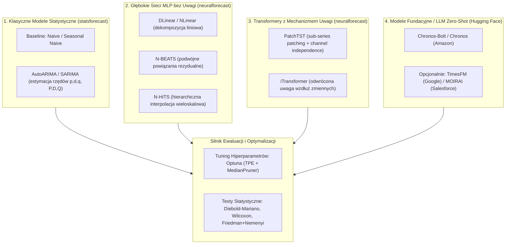

# Machine Learning Project 5: Roadmap & Implementation Plan
**"Prognozowanie szeregów czasowych: czy mechanizm uwagi jest potrzebny?"**  
*(Time Series Forecasting: Is the Attention Mechanism Needed?)*

---

## 1. Executive Summary & Research Hypothesis

* **Pytanie Badawcze**: Czy mechanizm uwagi (Self-Attention w architekturach Transformerowych) jest rzeczywiście niezbędny do osiągnięcia najwyższej jakości predykcji, czy też:
  1. Klasyczne bazy statystyczne (**ARIMA / SARIMA**),
  2. Zaawansowane sieci MLP z dekompozycją hierarchiczną (**N-BEATS, N-HiTS, DLinear**),
  3. Uniwersalne modele fundacyjne w trybie Zero-Shot (**Chronos-Bolt / Chronos 2**),
  zapewniają porównywalną lub lepszą dokładność przy niższym koszcie obliczeniowym i braku konieczności kosztownego trenowania od zera?
* **Strategia Realizacji (Zgodnie z ustaleniami z prowadzącym)**:
  * **Zero re-inventing the wheel**: Nie implementujemy architektur głębokich od zera w czystym PyTorch. Wykorzystujemy sprawdzone, zoptymalizowane biblioteki produkcyjne: `statsforecast` (modele statystyczne), `neuralforecast` (sieci głębokie) oraz Hugging Face / Amazon (`chronos-forecasting` dla modeli fundacyjnych).
  * **Uczciwy Benchmark (Fair Comparison)**: Zastosowanie biblioteki **Optuna** do automatycznego tuningu kluczowych hiperparametrów (długość okna wejściowego $L$, *learning rate*, wielkość batcha) w celu wyeliminowania błędu suboptymalnej konfiguracji.
  * **Ewaluacja Zero-Shot**: Modele LLM / Foundation (Chronos) testowane bez uczenia na zbiorze docelowym (zero-run).
  * **Rygor Statystyczny**: Weryfikacja różnic w wynikach za pomocą testów istotności statystycznej (**Diebolda-Mariano**, **Wilcoxona** oraz **Friedmana + Nemenyi** / diagram CD).

---

## 2. Architektura Modeli w Benchmarku

Modele podzielono na 4 logiczne grupy reprezentujące różne paradygmaty:

---

## 3. Szczegółowy Plan Działań (Fazy Projektu)

### Faza 1: Konfiguracja Środowiska i Nowe Zależności
- [x] **1.1. Rozszerzenie `pyproject.toml` o nowe pakiety**:
  - `optuna` (optymalizacja bayesowska hiperparametrów).
  - `chronos-forecasting` / `transformers` (dla modeli fundacyjnych Chronos / Chronos-Bolt).
  - `scikit-posthocs` (dla testów Nemenyi i generowania wykresów Critical Difference).
  - Synchronizacja przez `uv sync`.
- [x] **1.2. Standaryzacja wejścia danych pod `statsforecast` / `neuralforecast`**:
  - Konwersja zbiorów benchmarkowych (`ETTh1`, `Weather`, `Electricity` itd.) do standardowego formatu tabelarycznego: kolumny `[unique_id, ds, y]` akceptowanego natywnie przez obie biblioteki bez zbędnego boilerplate'u (`load_long_benchmark` w `dataset.py`).

---

### Faza 2: Implementacja Pipeline'u Modeli (Pre-built Integrations)

- [ ] **2.1. Pipeline Modeli Statystycznych (`src/ts_forecasting_benchmark/models/statistical.py`)**:
  - Wykorzystanie `StatsForecast(models=[AutoARIMA(season_length=...), SeasonalNaive(...)], freq=...)`.
  - Zapewnienie szybkiego fittingu na CPU.
- [ ] **2.2. Pipeline Głębokich Modeli MLP i Transformerów (`src/ts_forecasting_benchmark/models/neural.py`)**:
  - Wykorzystanie `NeuralForecast`:
    * MLP / Linear: `NBEATS`, `NHITS`, `DLinear`.
    * Attention: `PatchTST`, `iTransformer`.
  - Konfiguracja akceleracji sprzętowej (`accelerator="mps"` na Apple Silicon lub `"cuda"` / `"cpu"`).
- [ ] **2.3. Pipeline Modeli Fundacyjnych Zero-Shot (`src/ts_forecasting_benchmark/models/foundation.py`)**:
  - Integracja `ChronosBoltPipeline` (model `amazon/chronos-bolt-mini` / `base`).
  - Ewaluacja w trybie **Zero-Shot** (brak fittingu; podajemy wyłącznie okno kontekstowe $L$ i generujemy prognozę na horyzont $H$).

---

### Faza 3: Optymalizacja Hiperparametrów z Optuna

- [ ] **3.1. Moduł wyszukiwania Optuna (`src/ts_forecasting_benchmark/tuning/optuna_study.py`)**:
  - Przestrzeń poszukiwań (*search space*) dla modeli głębokich (`NHITS`, `NBEATS`, `PatchTST`, `DLinear`):
    * `input_size` (okno $L$): próby ze zbioru $\{96, 192, 336, 512\}$.
    * `learning_rate`: rozkład logarytmiczny $\log(10^{-5}, 10^{-2})$.
    * `batch_size`: $\{32, 64, 128\}$.
    * specyficzne parametry architektury (np. liczba stosów/bloków, dropout).
  - Strategia próbkowania: `TPESampler` (Tree-structured Parzen Estimator).
  - Wczesne odrzucanie słabych konfiguracji: `MedianPruner` (zatrzymuje trening po kilku epokach, jeśli walidacyjny błąd jest powyżej mediany).
- [ ] **3.2. Izolacja zbioru**:
  - Strojenie hiperparametrów przeprowadzane wyłącznie na podzbiorze walidacyjnym (np. `ETTh1` i `Weather`), a znalezione optymalne konfiguracje testowane na pozostałych benchmarkach.

---

### Faza 4: Dwuetapowy Eksperyment (Pilot vs Full Benchmark)

- [x] **4.1. Pilot Benchmark (Szybka weryfikacja poprawności)**:
  - Zbiory: `ETTh1` (target: `OT`).
  - Horyzont: $H = 96$.
  - Modele: `SeasonalNaive`, `AutoARIMA`, `NHITS`, `Chronos-Bolt (Zero-Shot)`.
  - Zweryfikowane w `scripts/run_pilot_benchmark.py`.
- [ ] **4.2. Pełny Benchmark**:
  - Zbiory: Pełna paleta benchmarkowa (`ETTh1`, `ETTm1`, `Weather`, `Electricity`).
  - Horyzonty: $H \in \{96, 192, 336, 720\}$.
  - Zapis surowych predykcji i reszt (niezbędnych do testów statystycznych) w `results/metrics/predictions/`.

---

### Faza 5: Testy Istotności Statystycznej i Analiza Wyników

- [ ] **5.1. Moduł testów statystycznych (`src/ts_forecasting_benchmark/evaluation/statistical_tests.py`)**:
  - **Test Diebolda-Mariano (DM)**: Porównanie par modeli (np. `DLinear` vs `PatchTST`, `NHITS` vs `Chronos`) z uwzględnieniem autokorelacji błędów predykcji wielokrokowej.
  - **Test Wilcoxona dla par**: Sprawdzenie czy różnice median błędów są istotne statystycznie ($p < 0.05$).
  - **Test Friedmana + post-hoc Nemenyi**: Analiza rangowa wszystkich modeli na macierzy zbiór $\times$ horyzont.
- [ ] **5.2. Wizualizacje i Raport Końcowy**:
  - Wykres **Critical Difference (CD) Diagram** (pokazujący grupy modeli statystycznie równoważnych).
  - Wykres **Pareto Front**: Dokładność (MSE) w funkcji czasu uczenia/inferencji (podkreślenie przewagi modeli liniowych/N-HiTS i zero-shot).
  - Przykładowe wykresy prognoz vs rzeczywistość w Jupyter Notebook (`notebooks/final_evaluation_report.ipynb`).

---

## 4. Następne Zadania do Zrobienia (Aktualny Sprint & GitHub Issues)

1. [x] **Zadanie 1**: Dodać pakiety `optuna`, `chronos-forecasting`, `scikit-posthocs` do `pyproject.toml`.
2. [x] **Zadanie 2**: Przygotować `load_long_benchmark` w `src/ts_forecasting_benchmark/data/dataset.py`.
3. [x] **Zadanie 3**: Uruchomić `scripts/run_pilot_benchmark.py` (SeasonalNaive, AutoARIMA, NHITS, Chronos-Bolt).
4. [ ] **Zadanie 4** ([Issue #1](https://github.com/ReptilianEye/ts-forecasting-benchmark/issues/1)): Dodać pozostałe modele do porównania: `DLinear`, `N-BEATS` oraz `PatchTST` w skrypcie benchmarkowym.
5. [ ] **Zadanie 5** ([Issue #2](https://github.com/ReptilianEye/ts-forecasting-benchmark/issues/2)): Zaimplementować moduł testów statystycznych (`src/ts_forecasting_benchmark/evaluation/statistical_tests.py` - Diebold-Mariano i Wilcoxon).
6. [ ] **Zadanie 6** ([Issue #3](https://github.com/ReptilianEye/ts-forecasting-benchmark/issues/3)): Przygotować skrypt strojenia Optuna dla modeli głębokich (`scripts/tune_optuna.py`).
7. [ ] **Zadanie 7** ([Issue #4](https://github.com/ReptilianEye/ts-forecasting-benchmark/issues/4)): Pełny benchmark LTSF (wielokrotne okna i horyzonty na ETTh1, Weather, Electricity).
8. [ ] **Zadanie 8** ([Issue #5](https://github.com/ReptilianEye/ts-forecasting-benchmark/issues/5)): Raport podsumowujący, wykres frontu Pareto oraz Critical Difference diagram.

